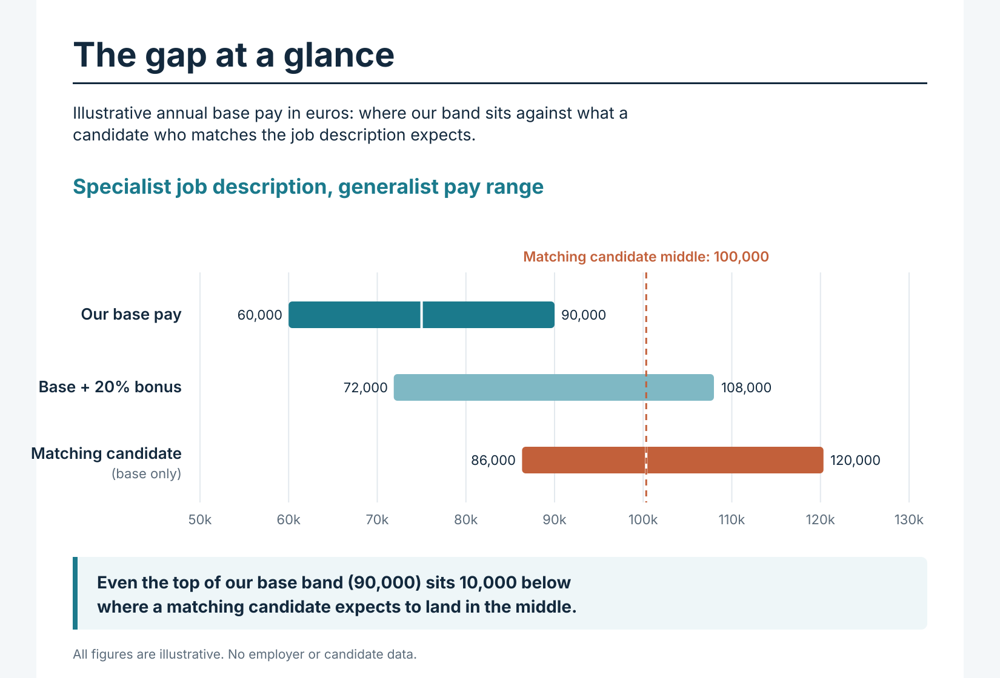
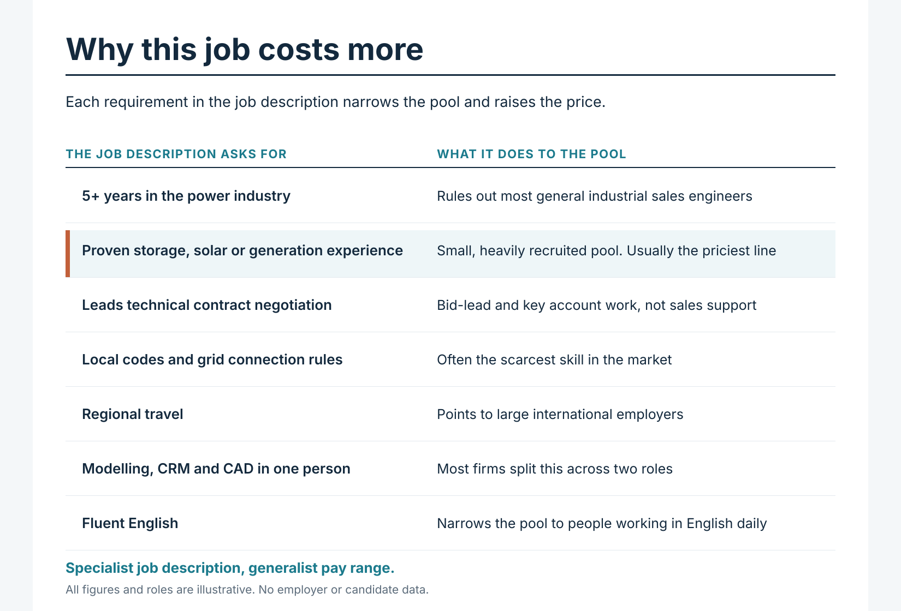
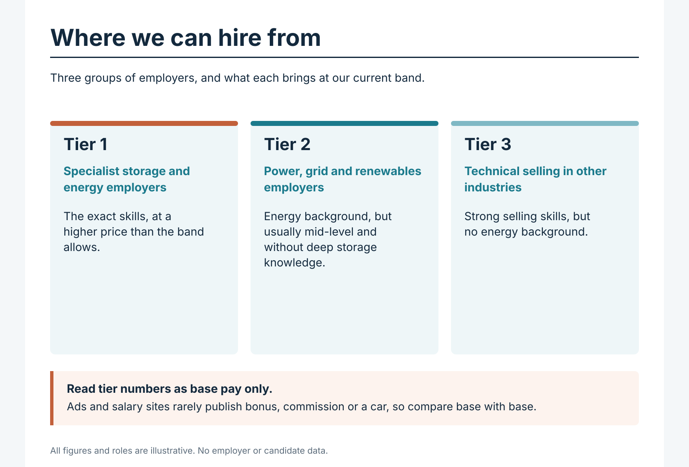
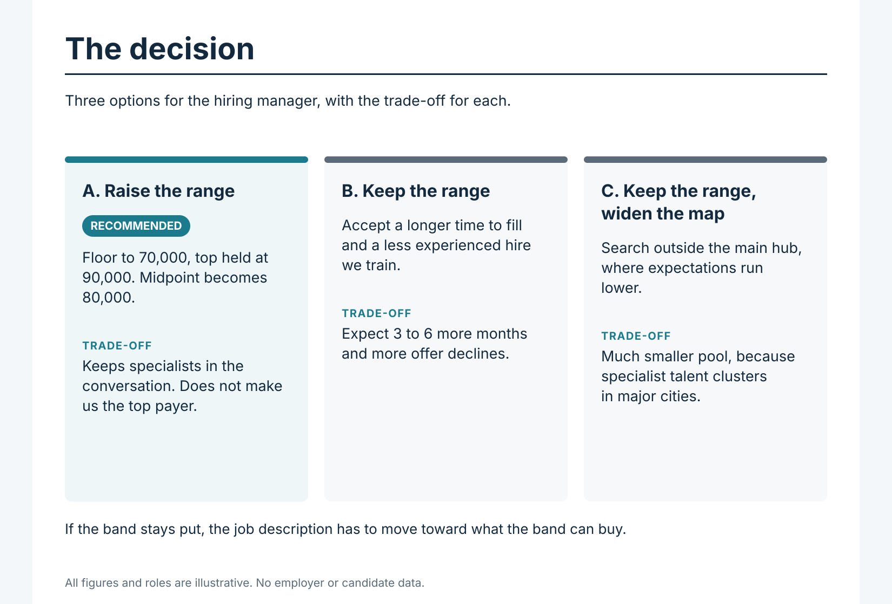
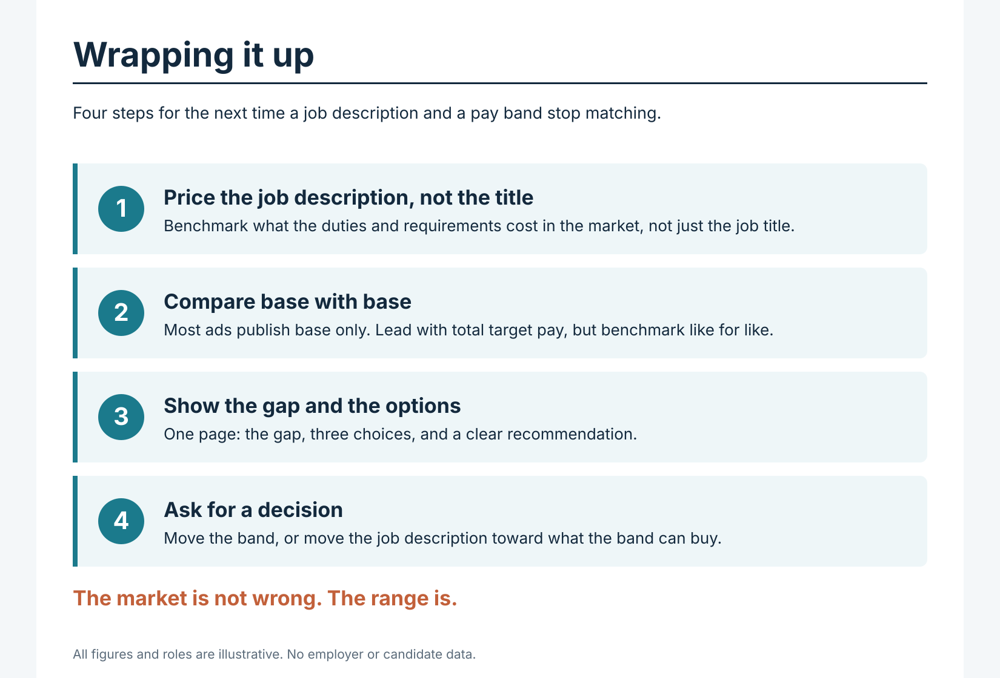

# comp-gap-playbook

### Compensation gap analysis: pricing a specialist job description

A case study and template for when the job description asks for a specialist and the pay band is set for a generalist. Written from a recruiter's seat, with a clear recommendation and the questions I would put to the hiring manager.

> **All figures, roles and companies below are illustrative.** Nothing here comes from a real employer or candidate. Swap in your own market data using the sources listed at the end.

---

## The situation

Example role: **Senior Sales Engineer, Energy Storage** (remote, one European market, regional travel).

The band was set for a general senior sales engineer. The job description asks for something else: 5+ years in the power industry, hands-on storage experience, ownership of technical contract negotiation, fluent English, and regional travel. Candidates are pushing back on pay, and the search is slow.

**The short version:** the band is fine for the title. It is not fine for the person the job description describes.

## The gap at a glance

Illustrative annual base pay, in euros.

| | Our base | Our base + 20% bonus | Matching candidate (base only) | Gap on base |
|---|---|---|---|---|
| Bottom | 60,000 | 72,000 | 86,000 | 26,000 short |
| Middle | 75,000 | 90,000 | 100,000 | 25,000 short |
| Top | 90,000 | 108,000 | 120,000 | 30,000 short |

Even the top of the band (90,000) sits 10,000 below where a matching candidate expects to land in the middle (100,000). Only the bonus-included figure at the very top gets past it.

## Why this job costs more than the title suggests

Each requirement narrows the pool and moves the hire into a more expensive part of the market.

| What the job description asks for | What it does to the pool | Where to benchmark it |
|---|---|---|
| Engineering degree plus 5+ years in the power industry | Rules out most general industrial sales engineers | Energy-sector pay surveys |
| Proven storage, solar or generation experience | Small, heavily recruited pool. Usually the most expensive line on the page | Live ads for storage specialists |
| Leading technical contract negotiation | This is bid-lead and key account work, not sales support | Key account manager and sales manager benchmarks |
| Local codes, standards and grid connection rules | Often the scarcest skill in the market | Recruiter salary guides for grid specialists |
| Regional travel | Points to large international employers | Employee-reported pay at those employers |
| Modelling, CRM and CAD in one person | Most firms split this across two roles | Not priced separately, pushes the hire senior |
| Fluent English | Narrows the pool to people already working in English | Not priced separately |

**Put simply:** a specialist job description was paired with a generalist pay range. The market is not wrong. The range is.

## Comparing against competitor tiers

I group the employers I source from into tiers, then average every usable pay figure for comparable roles.

| Tier | Who | What they bring at our band |
|---|---|---|
| 1 | Specialist storage and energy employers | The exact skills, at a higher price than the band allows |
| 2 | Power, grid and renewables employers | Energy background, but usually mid-level and without deep storage knowledge |
| 3 | Technical selling in other industries | Strong selling skills, but no energy background |

**Read tier numbers as base pay only.** Job ads and salary sites publish base. They rarely publish bonus, commission or a company car. If you quote base plus bonus against someone else's base, the comparison is unfair in both directions. The honest conclusion on total pay is often "we don't know who is ahead," and that should be said out loud.

Rules I apply when building averages:
- Exclude contractor and B2B rates, commission-led ranges, junior roles and non-sales engineering roles.
- Exclude stale figures, or weight them lightly.
- Report sample size next to every average. Small samples get a warning label.
- Take bonus out of any figure reported as total pay so base is compared with base.
- Keep company names out of anything shared widely.

## The decision

| Option | What it means | Trade-off |
|---|---|---|
| **A. Raise the range** (recommended) | Floor to 70,000, top held at 90,000. Midpoint becomes 80,000 | Does not make us the top payer. It keeps specialists in the conversation |
| **B. Keep the range** | Accept a longer time to fill and a less experienced hire we train | Expect 3 to 6 more months and more offer declines |
| **C. Keep the range, widen the map** | Search outside the main hub where expectations run lower | Much smaller pool, because specialist talent clusters in major cities |

*Check the arithmetic on any new band. If the midpoint is the average of floor and top, a 70,000 floor and 90,000 top give 80,000, not a higher number.*

## Questions for the hiring manager if the band stays put

1. Will you accept adjacent experience (grid, wind, solar) in place of direct storage experience, with storage taught on the job?
2. Will you drop "years in the power industry" as a must-have for candidates from other industries?
3. Can the hire support, rather than lead, technical negotiations in year one, with regional travel phased in later?
4. Some candidates want higher base, not a bigger bonus. Can we offer above-midpoint base to strong candidates, or shift part of target pay from bonus into base?

## What we do well (say it out loud)

- A strong target bonus matters, and many surveys ignore it. Lead with total target pay, not base alone.
- Fully remote is worth real money to candidates and costs nothing.
- The top of the band comfortably beats a general sales engineer. The problem is only that this is not a general sales engineer role.

## Reading candidate pushback

Pushback is a signal, not proof. I argue from market data, not from complaints, because individual candidates are rarely a clean read.

- **The overqualified candidate** benchmarks against senior global account pay, so any sales engineer band will look low. Useful as a ceiling, not a target.
- **The adjacent-background candidate** fits the pay but not the requirements. Useful as a reminder that the band buys a different profile than the job description describes.

Together they point to two problems: the range needs to move, and sourcing needs to retarget people with real storage, solar or grid experience.

**Check currencies first.** Confirm candidates and market data are in the same currency and the same gross or net basis before calling anything a gap.

## Data sources to use

Use only published or reported data you are allowed to share.

- National salary surveys and statistics offices
- Recruiter salary guides (published annually)
- Live job ads that state a pay range
- Employee-reported pay sites (small samples, label them as such)
- Pay transparency rules for your market, since ranges may already have to be disclosed

## How to reuse this

1. Copy the structure.
2. Replace the example role and figures with your own, sourced and dated.
3. Keep company, candidate and internal band details out of anything you publish.
4. Keep the one-line verdict at the top. A hiring manager should know the answer in ten seconds.
